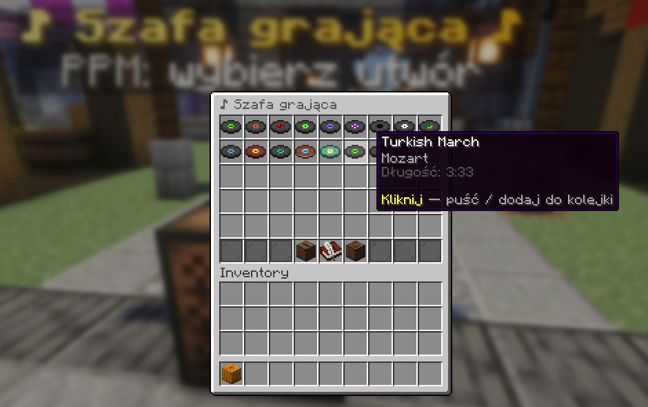

# SunSzafa

[English](README.md) · **Polski**

Szafa grająca na Paper 26.2. Odtwarza utwory z Note Block Studio (`.nbs`) dźwiękami bloków nutowych, ma kolejkę i hologram „teraz gra” nad szafą.

<p align="center">
  
</p>

## Co potrafi

- Szafą może być dowolny blok; gracz klika PPM i wybiera utwór z menu
- Wspólna kolejka dla wszystkich w pobliżu i hologram z aktualnym utworem
- Obsługuje pliki `.nbs` z [Open Note Block Studio](https://opennbs.org). Nowe wrzucasz do folderu i przeładowujesz, bez restartu.
- W zestawie melodie z domeny publicznej (Dla Elizy, Oda do radości, Korobeiniki, W grocie Króla Gór i inne)
- Każdy gracz może wyciszyć szafy u siebie przez `/szafa wycisz`, a ustawienie zostaje zapamiętane

## Wymagania

- Paper **26.2**
- Java **25**
- [SunCore](https://github.com/oonnyyx/SunCore)

## Instalacja

1. Pobierz `SunSzafa.jar` i `SunCore.jar` z zakładki [Releases](../../releases/latest).
2. Wrzuć oba pliki do `plugins/` i zrestartuj serwer.
3. Spójrz na blok (najlepiej wygląda szafa grająca) i wpisz `/szafa postaw`.
4. Własne pliki `.nbs` wrzuć do `plugins/SunSzafa/utwory/` i wpisz `/szafa reload`.

## Komendy

Alias: `/jukebox`. Komendy admina wymagają `szafa.admin` (domyślnie op).

| Komenda | Opis |
|---|---|
| `/szafa wycisz` | Wycisza albo przywraca muzykę u siebie (dla każdego) |
| `/szafa postaw` | Robi szafę z bloku, na który patrzysz |
| `/szafa usun` | Usuwa szafę, na którą patrzysz (blok zostaje) |
| `/szafa lista` | Lista wczytanych utworów |
| `/szafa stop` | Zatrzymuje wszystkie szafy |
| `/szafa reload` | Wczytuje nowe utwory z folderu |

## Budowanie

```bash
git clone https://github.com/oonnyyx/SunCore && cd SunCore && mvn install && cd ..
git clone https://github.com/oonnyyx/SunSzafa && cd SunSzafa && mvn package
```

## Licencja

[MIT](LICENSE)
